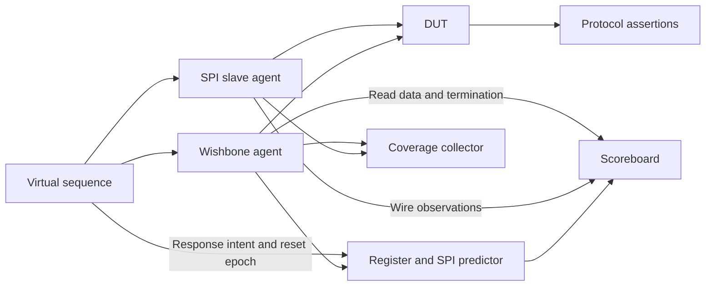

# Verification plan

## Evidence layers

- Phase 1 directed baseline uses unchanged upstream Icarus benches. Antmicro's independent UVM smoke runs a signal-duration example and qualifies only the exercised UVM constructs.
- Phase 2 directed tests drive the project engine and then the Wishbone peripheral. Check exact edge positions and full-duplex data against an independent peer before using the project VIP.
- Phase 3 uses Accellera UVM. The Wishbone master agent drives the register bus and publishes completed `ACK` or `ERR` transactions from its monitor. The SPI agent acts as a slave responder with a passive wire monitor. A virtual sequencer coordinates bus commands, slave response words, and reset. Each interface and agent has a configuration object. Use explicit test timeouts and check outstanding transactions at end of test.
- The predictor consumes accepted Wishbone writes and a queued slave response. Compare predicted CS, mode, width, MOSI and MISO to pin observations, then compare expected RX and status to Wishbone readbacks. Use a separate reset epoch to discard interrupted expectations. Avoid deriving expected SPI data from the observed SPI monitor stream.
- Phase 4 adds protocol SVA, functional bins and simulation coverage. Validate supported constructs on the pinned toolchain before relying on results. Phase 6 checks detection strength with intentional mutations and records the first failing checker.

| Testpoint | Directed check and assertion intent | Planned coverage |
|---|---|---|
| Mode and data | Verify first bit, launch and sample edges, both directions and final bit. | CPOL × CPHA, cross each mode with minimum and nominal divider. |
| Frame width | Build widths 1, 8, 16, 32. Check exactly twice that many SCLK edges and zero extension on RX. | Width by build configuration, merge metadata across compatible runs. |
| Divider | Test 1, 2, a non-power-of-two value, and `65535` with a longer timeout. Check spacing, setup and hold. | Min, nominal, non-power-of-two and max buckets. |
| CS selection | Build `NUM_CS=1, 3, 16`. Verify one-hot active CS, inactive high on other lines and invalid indexes. | Each reachable CS index in each build, same and alternate CS across successive words. |
| Completion | Verify BUSY through hold, one RX update per accepted START, sticky DONE, W1C and completion/clear precedence. | Single, consecutive same mode, consecutive mode change. |
| Reset | Assert reset idle, during bus response, CS setup, early/late shift and CS hold. Check defaults and successful restart. | Reset phase and post-reset completion. |
| Wishbone | Exercise `ACK` and `ERR` exclusion, request gating, canceled request, read data stability, byte-lane merge and continuous `CYC` across distinct transfers. | Register × operation × legal termination, lane masks, cancellation. |
| Errors | Exercise invalid index/divider, illegal direction, reserved bits, unaligned or unmapped addresses, zero select and busy START or configuration writes. Check unchanged state. | Reject reason × access category where reachable. |

Sample successful transfers at CS release and bus outcomes at termination. Give aborts separate bins. Qualify CS and width bins against elaboration parameters. Track unreachable combinations explicitly and report hit counts with tool, revisions, configurations and seeds. The Phase 1 checks do not establish project functional coverage.
